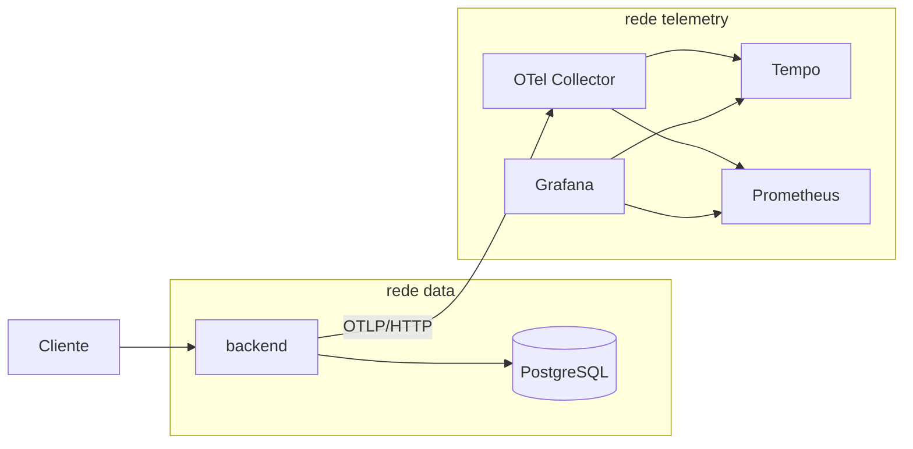

# Introdução

Monorepo (UV workspace Python) do ecossistema **Ressonant**: bibliotecas compartilhadas em `packages/*`, aplicações em `apps/*`, infraestrutura local em `infra/`. Cada app builda, sobe, testa e é mantida de forma independente.

# Propósito

Plataforma de comunicação e colaboração (categoria Slack). Hoje o backend cobre **autenticação, usuários, workspaces, equipes, Kanban, chat, mail, notificações, reações, read states, upload de imagens e gestão de workspace (RBAC/auditoria)**. Execução de fluxos por agentes de IA e RAG são **Planejado — Fase 4** no Plano Mestre Unificado.

# Arquitetura

```
apps/ressonant_backend/    FastAPI + PostgreSQL (routes → services → repository → models)
packages/                  libs Python compartilhadas (common-errors, common-logs, common-telemetry, ...)
infra/                     Postgres compartilhado e stack de observabilidade
docker-compose.yml         índice que agrega os composes de infra/ e de cada app
Makefile                   interface única: make help
```



Decisões:

- **Um compose por unidade, agregado na raiz por `include:`**: a raiz não define serviços, então apps não se acoplam. `docker compose up -d backend` sobe só o backend e suas dependências. Detalhes em [`docs/docker-compose.md`](docs/docker-compose.md).
- **Postgres e observabilidade são infra compartilhada** (`infra/`), em redes separadas (`data`, `telemetry`); cada app entra só nas redes de que precisa.
- **Build independente por app**: o `Dockerfile` de cada app usa a raiz como contexto e leva só os manifests das apps irmãs para o `uv.lock` fechar.
- **Migration como serviço one-shot** (`migrate`): o backend só sobe depois de ela terminar com sucesso.

# Pré-requisitos

- Docker com Compose v2
- [uv](https://docs.astral.sh/uv/) e `make`
- Python 3.13 (o uv instala se necessário)

# Quick Start

```bash
make setup                # cria .env (raiz e apps), instala deps e pre-commit
make infra-up             # PostgreSQL
make up APP=backend       # builda, migra e sobe o backend
curl localhost:8000/health/ready
```

API em <http://localhost:8000>, Swagger em <http://localhost:8000/docs>. `make help` lista todos os targets.

# Estado atual: o que está implementado

- **Backend implementado** (`apps/ressonant_backend`): health/readiness; autenticação JWT com bloqueio de tentativas no processo e revogação de access token (blacklist em memória, com Redis quando `REDIS_URL` está configurado); CRUD de usuários; workspaces e membros; equipes (com soft-delete); boards/colunas e cards (criar, listar, atualizar, mover, clonar, bloquear, desbloquear); canais, conversas e mensagens por HTTP e WebSocket autenticado; mail; notificações; reações; read states; upload de imagens; e as oito rotas de gestão de workspace com níveis `none|read|modify|grant`, R9/R10 e auditoria.
- **Integrações compartilhadas**: armazenamento compatível com S3 (endpoint configurável e fallback local quando não habilitado) e inicialização opcional de Datadog por `DD_TRACE_ENABLED`.
- **Ainda não implementado neste backend**: presença, busca avançada, preferências, refresh token (há método interno, mas nenhuma rota pública) e execução de fluxos por agentes de IA/RAG (**Planejado — Fase 4**).
- **Planejado — Fase 0/1 (não implementado)**: `GET /me/context` (D7; bootstrap canônico — hoje existe apenas `GET /auth/me`), `organizations`/`organization_members`/`invitations`, `plans`/`subscriptions` e os papéis de Dono da Empresa e Billing Owner. `/auth/bootstrap` **não será criado** (D7). `VITE_API_BASE_URL` (D1) também é **Planejado — Fase 0/1**, no frontend.

A spec OpenAPI versionada em `apps/ressonant_backend/openapi.json` cobre as rotas HTTP. O endpoint WebSocket é `/ws/{room_kind}/{room_id}` (por exemplo `/ws/channel/{room_id}` e `/ws/conversation/{room_id}`); autentique enviando `Sec-WebSocket-Protocol: bearer, <access_token>`.

A tabela abaixo destaca rotas de saúde, autenticação, usuários e gestão; o catálogo completo de requests e payloads está em `apps/ressonant_backend/openapi.json`. Há também uma collection Postman em `apps/rs_collections/postman/import-json/`:

| Método | Rota | Descrição |
| --- | --- | --- |
| GET | `/health` | Liveness |
| GET | `/health/ready` | Readiness (checa o banco) |
| POST | `/auth/register` | Cadastro público |
| POST | `/auth/login` | Login (retorna access token JWT) |
| POST | `/auth/logout` | Revoga o access token |
| GET | `/auth/me` | Dados do usuário autenticado |
| POST | `/users` | Cria usuário (admin) |
| GET | `/users` | Lista usuários (paginação/filtro, admin) |
| GET | `/users/{user_id}` | Busca (admin ou o próprio usuário) |
| PUT | `/users/{user_id}` | Atualiza (admin ou o próprio usuário) |
| PATCH | `/users/{user_id}/status` | Ativa/desativa (admin) |
| PATCH | `/users/{user_id}/admin` | Alterna `interno_adm` (admin) |
| DELETE | `/users/{user_id}` | Soft delete (admin) |
| GET | `/workspaces/{workspace_id}/management/access/me` | Nível efetivo, owner/`interno_adm` e capabilities |
| GET | `/workspaces/{workspace_id}/management/grants` | Lista grants ativos (leitura de gestão) |
| POST | `/workspaces/{workspace_id}/management/grants` | Cria/atualiza grant (`read\|modify\|grant`; R9) |
| DELETE | `/workspaces/{workspace_id}/management/grants/{target_user_id}` | Revoga grant (R9/R10) |
| GET | `/workspaces/{workspace_id}/management/people` | Membros do workspace |
| GET | `/workspaces/{workspace_id}/management/teams` | Equipes do workspace |
| GET | `/workspaces/{workspace_id}/management/blocked-cards` | Cards bloqueados |
| GET | `/workspaces/{workspace_id}/management/audit-events` | Eventos de auditoria (paginação) |

> Não confundir com o **Planejado — Fase 0/1**: não existe `GET /me/context`, nem rotas `/organizations` ou `/plans` neste backend. A matriz completa de atores está em [`apps/ressonant_backend/docs/management-actor-action-matrix.md`](apps/ressonant_backend/docs/management-actor-action-matrix.md).

> O frontend (Ressonant) ainda não consome esse backend como fonte única: a camada de dados de chat, kanban, mail, notificações e tempo real permanece em mock (`localStorage`) por trás dos contratos em `src/repositories/contracts.ts` do frontend. A unificação em `VITE_API_BASE_URL` é **Planejado — Fase 0/1** (D1).

## Como iniciar o backend (local, sem Docker)

```bash
make setup            # cria .env (raiz e apps) com AUTH_SECRET, instala deps
make infra-up         # sobe o PostgreSQL
make migrate APP=backend   # roda as migrations (alembic upgrade head)
make up APP=backend   # sobe a API (uvicorn) em http://localhost:8000
curl localhost:8000/health/ready
```

Ou via Docker Compose: `docker compose up -d backend` (o compose sobe migrate + backend). Swagger: <http://localhost:8000/docs>.

## Configuração

`make setup` copia os `.env.example` (fonte de verdade das variáveis) e gera um `AUTH_SECRET` aleatório. Nada com segredo é versionado.

| Arquivo | Conteúdo |
| --- | --- |
| [`.env.example`](.env.example) | `POSTGRES_*`, portas, credenciais do Grafana |
| [`apps/ressonant_backend/.env.example`](apps/ressonant_backend/.env.example) | `DATABASE_URL`, `AUTH_SECRET`, `ACCESS_TOKEN_EXPIRE_MINUTES`, `CORS_ORIGINS`, `ENVIRONMENT`, `PORT`, `LOG_LEVEL`, `REDIS_URL`, `OTEL_*`, `AWS_S3_*`, `DD_*`, admin inicial |

**Planejado — Fase 0/1 (não implementado):** a configuração do frontend passará a usar `VITE_API_BASE_URL` (D1, única variável de URL) e `VITE_DATA_MODE` (`mock|http`). Essas variáveis **não existem** neste monorepo; as atuais `VITE_DATA_API`, `VITE_AUTH_API`, `VITE_KANBAN_API`, `VITE_MANAGEMENT_API` e `VITE_MANAGEMENT_URL` vivem no repositório do frontend, fora daqui.

## Comandos do dia a dia

`APP` aceita `backend` ou `ressonant_backend`.

| Tarefa | Comando |
| --- | --- |
| Subir só o Postgres | `make infra-up` |
| Subir / parar um app | `make up APP=backend` / `make down APP=backend` |
| Build isolado | `make build APP=backend` |
| Logs | `make logs APP=backend` |
| Status | `make ps` |
| Migrations no Docker | `make migrate APP=backend` |
| Testes de um app / de tudo | `make test APP=backend` / `make test` |
| Gate completo (lint, format, types, testes) | `make check` |
| Criar o primeiro admin | `make -C apps/ressonant_backend migrate/create-admin` (preencha `ADMIN_*` no `.env`) |
| Nova migration | `make -C apps/ressonant_backend migrate/generate msg="..."` |

Equivalentes em Compose puro (da raiz): `docker compose up -d postgres`, `docker compose up -d backend`, `docker compose build backend`, `docker compose logs -f backend`, `docker compose stop backend`, `docker compose down`.

Nenhum desses comandos remove volumes: os dados do Postgres persistem em `ressonant_backend_pg-data`.

## Testes

- Unitários (SQLite em memória, sem Docker): `make test APP=backend`.
- Integração real contra API + Postgres no ar: `API_BASE_URL=http://localhost:8000 make -C apps/ressonant_backend test-integration`.

## Observabilidade (Grafana)

```bash
make observability-up     # collector, Tempo, Prometheus, Grafana
make up APP=backend       # gera telemetria
```

| | |
| --- | --- |
| Grafana | <http://localhost:3001> |
| Usuário / senha (só dev local) | `admin` / `ressonant-dev` (`GRAFANA_ADMIN_*` no `.env`) |
| Prometheus | <http://localhost:9090> |

Datasources (Prometheus, Tempo) e o dashboard **Ressonant → Ressonant Backend** já vêm provisionados. Como verificar a telemetria, configurar novas apps e troubleshooting: [`GRAFANA.md`](GRAFANA.md).

## Collections da API

As collections Postman ficam fora do monorepo, em `../ressonant-api-collections` (README próprio, gerada do `openapi.json` do backend).

# Adicionar um novo app

Checklist em [`docs/docker-compose.md`](docs/docker-compose.md#adicionar-uma-app): pasta `apps/ressonant_<nome>/` com `Dockerfile`, `docker-compose.yml`, `.env.example` e `Makefile`; include no compose da raiz; liberar no `.dockerignore`. Estrutura interna de apps Python: [`docs/guides/app-structure.md`](docs/guides/app-structure.md); libs: [`packages/README.md`](packages/README.md).

# Troubleshooting

| Sintoma | Correção |
| --- | --- |
| `defina POSTGRES_PASSWORD no .env` ou `.env ausente` | `make setup` |
| `App 'x' não encontrado` | use `APP=backend` (nomes: `ls apps`) |
| Porta 5432/8000/3001 em uso | ajuste `POSTGRES_PORT`/`BACKEND_PORT`/`GRAFANA_PORT` no `.env` |
| Backend não sobe | `make logs APP=backend`; a migration roda antes: `docker compose logs migrate` |
| `AUTH_SECRET deve ter ao menos 32 caracteres` | preencha no `apps/ressonant_backend/.env` (`make setup` gera) |
| Senha do Postgres recusada | o volume guarda a senha da primeira criação; use a mesma em `POSTGRES_PASSWORD` |
| `uv sync --locked` falha | `uv lock` e commite o `uv.lock` |

# Deploy

Não documentado nesta fase; seguir o README de cada membro em `apps/` ou `packages/` quando existir.

# Read more

- [`GRAFANA.md`](GRAFANA.md): Grafana e telemetria
- [`apps/ressonant_backend/README.md`](apps/ressonant_backend/README.md): API
- [`docs/docker-compose.md`](docs/docker-compose.md): orquestração local
- [`docs/ci-cd.md`](docs/ci-cd.md): CI/CD
- [`docs/adrs/0001-http-snake-case.md`](docs/adrs/0001-http-snake-case.md): snake_case no contrato HTTP
