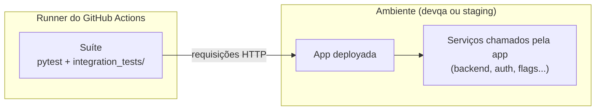

# Testes integrados

Guia dos testes integrados de todas as apps do monorepo: o que cobrir, as regras e padrões das suítes, e o fluxo de
escrita e execução. As skills `integration-tests-plan` e `integration-tests-implement` seguem este guia.

Nos exemplos, `<APP>` é o nome da app em maiúsculas, com `_` no lugar de `-` (`ressonant-bff` → `Ressonant_BFF`).

## Introdução

O teste unitário prova que a lógica da app está certa, com as dependências trocadas por mocks. O teste integrado prova
que a app funciona conectada ao ambiente: a rota está publicada, a autenticação real aceita credenciais válidas e
rejeita as inválidas, os serviços chamados respondem no formato esperado e o consumidor recebe o contrato combinado. Ou
seja, um não substitui o outro.

|                   | Unitário (`tests/`)                             | Integrado (`integration_tests/`)                        |
|-------------------|-------------------------------------------------|---------------------------------------------------------|
| O que valida      | Lógica: regras, mapeamentos, tratamento de erro | Integração: rota, autenticação, contrato com serviços   |
| Dependências      | Mocks (HTTP, auth, flags, Redis)                | Reais, no ambiente deployado                            |
| Onde roda         | Localmente (`make test`) e em toda PR           | Contra devqa ou staging, em workflow próprio            |
| Custo por cenário | Milissegundos                                   | Segundos; exige ambiente, massa e flags no estado certo |
| Quantidade        | Muitos cenários, todas as variações             | Poucos, só o que o ambiente real revela                 |

### Características de uma boa suíte

- **Enxuta:** poucos cenários por endpoint; cada um a mais é tempo de execução e um ponto de instabilidade.
- **Determinística:** não depende da ordem dos testes nem de estado do ambiente além dos pré-requisitos do plano.
- **Independente:** cada teste cria a própria massa, com identificadores únicos.

### Como funciona

A suíte não sobe a app. Ela é um cliente HTTP que roda num runner do GitHub Actions e faz requisições
para a app já deployada no ambiente, como faria um front-end.



As URLs chegam à suíte por variáveis de ambiente, declaradas no `deploy-config.yaml` da app. A app processa cada
requisição de verdade, chamando os serviços reais; os testes verificam só o status e o corpo da resposta. Por isso um
teste que falha não aponta uma linha de código: a causa é investigada nos logs da app no ambiente.

## 1. Princípios

- A suíte é black-box: fala HTTP com a app já deployada (devqa ou staging). Nada é mockado e nenhum código da app é
  importado por testes, builders ou fixtures. A única exceção é o inventário (§10), que importa a app para ler as rotas.
- Ela fica em `apps/<app>/integration_tests/` e nunca é coletada junto com os unitários (`testpaths = ["tests"]` no
  `pyproject.toml` da app).

## 2. O que cobrir

Critério: **o problema passaria despercebido pelo teste unitário?** Se não, o cenário fica no unitário.

**Sempre cobrir:**

- **Caminho feliz de cada endpoint**, verificando os campos que o consumidor usa. É onde aparece a mudança de contrato
  de um serviço chamado, que o mock não acusa.
- **Efeito de cada escrita, confirmado por leitura**: depois de um POST, PUT, PATCH ou DELETE bem-sucedido, o teste
  chama o endpoint de leitura do recurso (GET) e confirma o efeito: o recurso criado existe com os valores enviados, a
  alteração foi aplicada, o removido devolve 404. Como a suíte não acessa o banco, só a resposta da escrita não prova
  nada: um endpoint que devolve sucesso sem persistir passaria no caminho feliz. Se o recurso não tem endpoint de
  leitura, o plano registra o cenário como verificado só pela resposta.
- **Autenticação negada em cada endpoint protegido**: requisição sem credencial recebe 401. Nos unitários a
  autenticação é mockada; só aqui se prova que a rota exige credencial, e uma dependência de auth esquecida deixaria o
  endpoint aberto. Endpoint que exige um papel também recebe o cenário de credencial válida com o papel errado (403).
- **Erros do serviço chamado que a entrada consegue provocar**, como id inexistente (404) ou duplicidade (409). Não se
  testa a regra que gerou o erro, e sim se a app o traduz para o contrato certo.

**Não cobrir:**

- **Regras de negócio**: ficam no unitário.
- **Validação de payload (422)**: o teste unitário de entrypoint, que chama a rota real com as dependências mockadas, já
  prova que a rota usa o schema certo. Exceção: o 422 devolvido por um serviço chamado e repassado pela app.
- **Falhas de infraestrutura** (timeout, serviço fora do ar, 5xx): não podem ser provocadas de forma repetível num
  ambiente compartilhado.

## 3. Estrutura

```
integration_tests/
├── inventory.py            # inventário de cobertura (§10)
├── conftest.py             # só fixtures genéricas; não conhece nenhum domínio
├── .plans/                 # gitignored; planos gerados pela skill integration-tests-plan
├── config/
│   ├── settings.py         # BaseSettings com prefixo <APP>_IT_
│   ├── http_client.py      # wrapper de httpx.Client síncrono
│   └── constants.py        # prefixo da massa (§7)
├── builders/
│   ├── base.py             # helpers de prefixo e de identificadores únicos
│   └── <entidade>_builder.py
└── modules/<modulo>/
    ├── conftest.py         # fixture `seed` do módulo e limpeza
    └── entrypoints/rest/
        └── test_<router>_integration.py
```

`modules/<modulo>/` espelha o módulo da app e `entrypoints/rest/` o local do router
([`app-structure.md`](app-structure.md)): um arquivo de teste por router, com o mesmo nome do router
(`cep_v4_router.py` → `test_cep_v4_router_integration.py`). Todo diretório Python tem `__init__.py`. O que é específico
de um módulo (fixture `seed`, constantes de massa) fica no `conftest.py` ou em arquivos do módulo.

## 4. Ambiente e execução

- Tudo que muda entre ambientes vem de variáveis `<APP>_IT_*`, nunca de valor fixo no código. No CI, os valores vêm do
  bloco `integration_tests` do `deploy-config.yaml` da app (em devqa, com `__STACK_NAME__` no lugar da stack);
  localmente, do `.env`.
- O timeout (`<APP>_IT_HTTP_TIMEOUT_SECONDS`) vale para cada requisição HTTP, não para a suíte.
- Cada URL pela qual a app é exposta tem sua variável e seu client. O teste usa a URL pela qual o endpoint é consumido
  de fato, e as rotas internas usam a URL interna.
- Antes de rodar, a suíte chama o healthcheck da app e aborta com uma mensagem única se ela estiver fora.
- O cliente HTTP é síncrono (`httpx.Client`), o que dispensa `pytest-asyncio`.
- As dependências da suíte ficam só no grupo `integration` do `pyproject.toml` da app, e ela roda com
  `uv run --only-group integration`, sem instalar a app. Dependência nova da suíte entra nesse grupo.
- Não se usa `--cov`: o código exercitado roda no processo da app, não no do teste.
- O `Makefile` da app expõe `itest`/`ditest` (suíte), `itest-inv`/`ditest-inv` (inventário) e os targets que o workflow
  chama, `ci/integration-test` e `ci/integration-test/inventory` (ver [`docs/ci-cd.md`](../ci-cd.md)).

## 5. Retry

- O retry é opcional, por chamada, e só para um downstream instável registrado no plano. Ele é configurado por
  `retry_on` (status que disparam nova tentativa), `attempts` e `backoff` (segundos entre tentativas).
- Não há retry por padrão. Um 500 só entra em `retry_on` quando o plano o declara para aquele endpoint; fora disso, o
  retry esconderia um bug real.
- Em POST e PATCH, o retry só vale se o endpoint for idempotente, e quem decide isso é o dev.
- Cada nova tentativa é registrada no log com método, path e status.

## 6. Autenticação

- O tipo de autenticação de cada endpoint é o das dependências da rota.
- Cada tipo tem um mecanismo de obtenção de credencial na suíte. Ele nasce quando o primeiro endpoint daquele tipo é
  testado e é reutilizado pelos seguintes.
- A suíte não improvisa fluxo de autenticação: se falta mecanismo para um tipo, o dev define como obter a credencial.
- Credenciais vêm de variáveis `<APP>_IT_*` (secrets no CI) e nunca são versionadas.

## 7. Massa de dados

- A massa é criada via endpoints. Escrever direto no banco de outro componente é exceção, com aprovação registrada no
  plano.
- Os builders se chamam `build_and_save_<entidade>`, porque o nome deve revelar que há escrita. Eles criam as
  dependências que faltarem e aceitam dependências prontas por parâmetro.
- Os identificadores são únicos por execução (uuid4, sufixo aleatório, CPF e e-mail únicos). A unicidade vem da geração
  aleatória, nunca do prefixo.
- O prefixo de massa (constante em `config/constants.py`) vai no campo textual principal da entidade (`name`,
  `description`…) e serve só para identificá-la.
- A massa pré-provisionada (usuário, médico e partner de teste) não é criada nem removida pela suíte e não leva o
  prefixo.

## 8. Limpeza

A limpeza é decidida por plano e vale só para a massa criada pelos builders:

- **Sem limpeza:** é a opção válida e padrão. A massa fica no ambiente, identificada pelo prefixo, e um processo
  externo, desacoplado da suíte, cuida da remoção.
- **Remoção via endpoint:** o `seed` registra o que criou e remove no teardown, pelo endpoint de remoção do recurso. Só
  faz sentido quando esse endpoint existe e a massa acumulada atrapalharia os próprios testes ou o ambiente.

A suíte nunca remove por filtro de prefixo: execuções concorrentes apagariam a massa umas das outras.

## 9. Cenários

- O arquivo é `test_<router>_integration.py`, com uma classe externa por endpoint, que leva o marcador (§10). Dentro
  dela há uma classe aninhada por tipo de cenário, criada só quando o tipo tem cenário: `TestSuccess` (caminho feliz e
  variações), `TestErrors` (erros do downstream) e `TestAuth` (401 e 403). Cada método é um cenário, e as classes
  aninhadas herdam o marcador da externa.
- Os nomes seguem `test_should_<ação_esperada>` no caminho feliz e `test_should_return_<status>_when_<condição>` nos
  erros.
- As asserções verificam o status e os campos do corpo que o consumidor usa.
  registrado como pré-requisito do ambiente, porque o estado da flag muda por ambiente e, fora do estado exigido, a
  suíte quebra. Se a flag é avaliada com contexto (usuário, organização, partner), o estado vale também para a massa
  pré-provisionada.
- Chamadas com custo ou efeito externo real (SMS, WhatsApp, assinatura digital, agentes de IA) ficam fora da suíte até
  haver decisão própria, e o plano as lista como não cobertas.

## 10. Inventário de cobertura

```python
@pytest.mark.endpoint("POST /api/v4/physicians/protocols")
class TestCreateProtocol:
    class TestSuccess:
        def test_should_create_protocol(self, ...): ...

    class TestAuth:
        def test_should_return_401_when_token_is_missing(self, ...): ...
```

- O valor do marcador é `"<MÉTODO> <path>"`, com o path exatamente como declarado no router (`{protocol_id}`, não o
  valor substituído).
- Cada método de teste conta como um cenário. Um teste que atravessa vários endpoints declara um marcador por endpoint.
- O `make itest-inv` cruza os marcadores com as rotas da app e lista, por domínio, os endpoints cobertos, o número de
  cenários e os que estão sem teste. No GitHub Actions, o relatório também vai para o Step Summary.
- Marcador que aponta para rota inexistente, ou mal formado, faz o inventário falhar.
- Teste sem marcador não conta como cobertura. Não existe inventário versionado: o relatório é sempre gerado do código.

## Exemplo

Router fictício do `ressonant-bff`, `ressonant_bff/favorites/entrypoint/rest/favorites_router_v4.py`:

- `POST /api/v4/physicians/favorites` — cria um medicamento favorito do médico.
- `DELETE /api/v4/physicians/favorites/{favorite_id}` — remove o favorito.

### 1. Planejar

No Claude Code, rode `/integration-tests-plan`. A skill lê o router e as camadas abaixo dele, avisa se algum endpoint já
tem cobertura e pergunta:

1. **Qual app?** `ressonant-bff`.
2. **Qual router ou endpoint?** Cole o caminho do router.
4. **Massa:** o que já existe no ambiente (médico de teste) e o que o teste precisa criar.
5. **Limpeza:** remover a massa ao fim do teste ou deixá-la para o processo externo de limpeza, que é uma opção válida.

**Resultado:** `apps/ressonant-bff/integration_tests/.plans/favorites.plan.md`, com cenários, status esperado,
autenticação, massa e pré-requisitos de flag. Não é versionado. Revise-o antes de seguir.

### 2. Implementar

Rode `/integration-tests-implement`. A skill confirma a app, o plano e a aprovação, e resolve pendências (autenticação
sem mecanismo, flag sem caminho decidido) antes de escrever código.

**Resultado:**

| Arquivo                                                                                     | Quando é criado                                            |
|---------------------------------------------------------------------------------------------|------------------------------------------------------------|
| `integration_tests/config/settings.py`, `http_client.py`, `constants.py`                    | Só na primeira implementação da app                        |
| `integration_tests/conftest.py`                                                             | Só na primeira implementação da app                        |
| `integration_tests/builders/base.py`                                                        | Só na primeira implementação da app                        |
| `integration_tests/builders/favorite_builder.py`                                            | Quando o plano precisa de uma entidade sem builder         |
| `integration_tests/modules/favorites/conftest.py`                                           | Uma vez por módulo (fixture `seed` e limpeza)              |
| `integration_tests/modules/favorites/entrypoints/rest/test_favorites_router_integration.py` | Uma vez por router; novos cenários entram no mesmo arquivo |

As classes e o marcador seguem §9 e §10:

```python
@pytest.mark.endpoint("DELETE /api/v4/physicians/favorites/{favorite_id}")
class TestDeleteFavorite:
    class TestSuccess:
        def test_should_delete_favorite(self, seed, public_http_client): ...

    class TestErrors:
        def test_should_return_404_when_favorite_does_not_exist(self, public_http_client): ...

    class TestAuth:
        def test_should_return_401_when_token_is_missing(self, public_http_client): ...
```

### 3. Validar

```sh
make -C apps/ressonant-bff itest-inv    # ou ditest-inv, no container
```

O inventário lista, por domínio, os endpoints cobertos, o número de cenários e os sem teste; os dois de `favorites`
devem aparecer como cobertos. Marcador que aponta para rota inexistente faz o comando falhar. Como o inventário importa
a app para ler as rotas, localmente ele exige o `.env` da app preenchido, como o `make up`.

### 4. Abrir a PR

A PR leva os arquivos da etapa 2; o plano fica fora.

## Como executar

**Pré-requisito:** a app está habilitada nos workflows de testes integrados (ver [
`docs/ci-cd.md`](../ci-cd.md#workflow-integration-test-integration-test-appyaml)).

### Da sua máquina

Para executar os testes da sua máquina contra uma stack deployada, defina no `.env` da app as variáveis `<APP>_IT_*`
(URLs e credenciais da stack), como no bloco `integration_tests` do `deploy-config.yaml`. A suíte completa roda pelo
Makefile:

```sh
make -C apps/ressonant-bff itest     # ou ditest, no container (lê as variáveis do .env da app)
```

Para um arquivo, uma classe ou um teste específico, use o pytest direto, a partir de `apps/<app>`:

```sh
uv run --only-group integration pytest -ra -v integration_tests/modules/favorites/entrypoints/rest/test_favorites_router_integration.py
uv run --only-group integration pytest -ra -v integration_tests/modules/favorites/entrypoints/rest/test_favorites_router_integration.py::TestDeleteFavorite
uv run --only-group integration pytest -ra -v integration_tests/modules/favorites/entrypoints/rest/test_favorites_router_integration.py::TestDeleteFavorite::TestSuccess::test_should_delete_favorite

# por trecho do nome
uv run --only-group integration pytest -ra -v integration_tests -k delete_favorite
```

### Pelo GitHub Actions

Pela interface do GitHub, nos workflows `integration-test-devqa.yaml` e `integration-test-staging.yaml`, informando a
app. Ao fim, o resultado e o inventário são publicados no Step Summary da action.

**Em devqa**, sempre por disparo manual: cada dev sobe a própria stack e só ele sabe quando ela está pronta. Informe o
nome da stack. Se um serviço satélite não estiver disponível em devqa, aponte-o para o `mock-services`, com os mocks
preparados para os cenários.

**Em staging**, manual por enquanto. O plano é rodar automaticamente na esteira, logo depois do deploy em staging, para
barrar uma versão que quebrou a integração antes da produção. Quando este guia foi escrito, essa etapa ainda não
existia; confira o `deploy-staging.yaml` e o [`docs/ci-cd.md`](../ci-cd.md).

planos e que a massa pré-provisionada está disponível.
