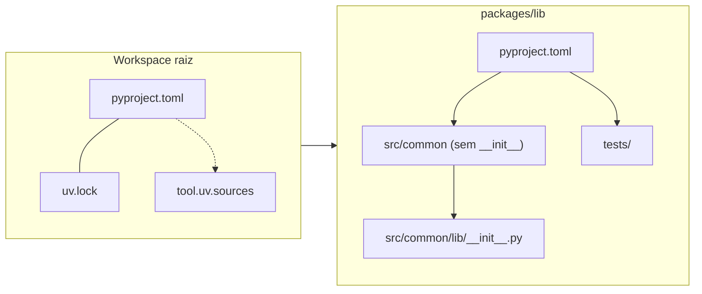

# Introdução

Esta pasta concentra as **bibliotecas partilhadas** (`packages/*`) do monorepo, expostas sob o **namespace `common`** (ex.: `common.logs`, `common.errors`). Cada lib é um membro do **UV workspace** declarado em [`pyproject.toml`](../pyproject.toml) (`[tool.uv.workspace] members = ["packages/*", "apps/*"]`).

> Além deste `README.md` geral das libs, **cada lib terá o seu próprio `README.md`** dentro de `packages/<lib>/` (ex.: `packages/exceptions/README.md`, `packages/logging/README.md`), descrevendo uso, API e exemplos específicos daquela lib.

# Quick Start

Passo a passo para criar uma nova lib do zero.

1. Copiar o molde para a pasta da lib:

```bash
cp templates/pyproject.lib.toml packages/<nome>/pyproject.toml
```

2. Em `packages/<nome>/pyproject.toml`, ajustar `name` (padrão **`common-<lib>`**, ex.: `common-logs`) e `description`.

3. Criar a árvore esperada (incluindo um `README.md` próprio da lib, com uso/API/exemplos):

```
packages/<lib>/
├── README.md
├── pyproject.toml
├── src/
│   └── common/         # SEM __init__.py (PEP 420)
│       └── <lib>/
│           └── __init__.py
└── tests/
```

4. Sincronizar o workspace a partir da raiz:

```bash
make setup
```

5. Para que outras libs ou apps possam consumir esta nova lib, adicionar a entrada correspondente em `[tool.uv.sources]` na [`pyproject.toml`](../pyproject.toml) raiz (ex.: `common-logs`, …).

# Read more

- [`templates/pyproject.lib.toml`](../templates/pyproject.lib.toml) — molde oficial, com a árvore esperada no cabeçalho.
- [`README.md`](../README.md) — visão geral do monorepo e Quick Start global (`make setup` / `make check`).

# Deploy

Não há fluxo de publicação configurado neste repositório nesta fase. O `pyproject.toml` de cada lib já está pronto para gerar wheel via **hatchling** (ver [`templates/pyproject.lib.toml`](../templates/pyproject.lib.toml)); o canal de distribuição (registry interno ou outro) será definido em PR posterior.

# Arquitetura



Convenções principais que este diagrama reflecte:

- **PEP 420 (namespace package):** `src/common/` **não** tem `__init__.py`. Isto permite que múltiplas libs partilhem o namespace `common.*` sem colidir. O hook [`hooks/check_no_common_init.py`](../hooks/check_no_common_init.py) impede regressão.
- **`requires-python == "==3.13.*"`:** uniforme em todos os `pyproject.toml` do repo. Verificado por [`hooks/check_requires_python_consistent.py`](../hooks/check_requires_python_consistent.py).
- **Naming:** `name = "common-<lib>"` no `[project]`, `version = "0.1.0"` na criação.
- **Build backend:** [hatchling](https://hatch.pypa.io/latest/) com `[tool.hatch.build.targets.wheel] packages = ["src/common"]`, coerente com o namespace. **Exceção:** `packages/telemetry` (`common-telemetry`) não tem código-fonte — é um agrupador de dependências de instrumentors OpenTelemetry, usando `bypass-selection = true` para gerar um wheel vazio. Ver [`packages/telemetry/README.md`](telemetry/README.md).
- **Workspace UV:** a lib é instalada em modo desenvolvimento via `uv sync` da raiz (`make setup`); consumidores apontam-na em `[tool.uv.sources]` na [`pyproject.toml`](../pyproject.toml) raiz.
- **Testes da lib:** ficam em `packages/<lib>/tests/`; não há testes na raiz do monorepo.

# Referências

- [PEP 420 — Implicit Namespace Packages](https://peps.python.org/pep-0420/)
- [Hatchling — Build backend](https://hatch.pypa.io/latest/)
- [uv — Workspaces](https://docs.astral.sh/uv/concepts/workspaces/)
