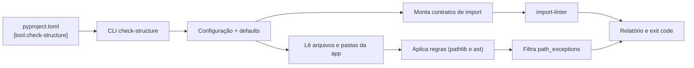

# Introdução

Biblioteca **common-check-structure** (`common.check_structure`): valida estrutura, nomenclatura e direção de imports das apps do monorepo Ressonant, como código executável (o equivalente ao ArchUnit no mundo Python). Cada app declara sua configuração em `[tool.check-structure]` no próprio `pyproject.toml`. Só `root_package` é obrigatória; as demais chaves têm default, e a app sobrescreve só o que precisar.

# Quick Start

1. Adicione `common-check-structure` como dependência dev da app (ou use o grupo dev da raiz, que já a inclui):

```bash
uv add --package <sua-app> --dev common-check-structure
```

2. Declare a configuração mínima no `pyproject.toml` da app:

```toml
[tool.check-structure]
root_package = "app"
```

3. Rode a verificação a partir do diretório da app:

```bash
uv run check-structure            # só reporta, exit code 0
uv run check-structure --strict   # exit code 1 se houver violação
```

As apps expõem o mesmo comando no Makefile: `make check-structure` e `make check-structure STRICT=1`. Na raiz do monorepo, `make check-structure` valida o isolamento de `packages/*` e roda o check de cada app que tem o target (com `STRICT=1`, falha se qualquer um deles tiver violação).

## Regras

Uma regra é uma verificação automática sobre o código de uma app, que reporta cada violação encontrada. Exemplos: "um arquivo de `usecases` não pode importar de `entrypoints`" e "arquivos de `usecases` terminam em `_usecase.py`".

Toda regra tem um id estável (ex.: `file-names`), que a app usa para desligá-la (`disable`) ou para liberar um caso específico (exceções, descritas em [Configuração](#configuração)). Cada regra é implementada em um arquivo próprio, com o id numa constante, e pertence a um de dois tipos:

- **Contrato de import:** diz quem pode ou não importar quem. A verificação é feita pelo `import-linter`.
- **Regra de arquivos e pastas:** diz onde um arquivo pode ficar e como ele, suas pastas e suas classes se chamam. A verificação lê os caminhos e o código-fonte.

### Como cada tipo é implementado

**Contrato de import** — `services/contracts/<regra>.py`.

- Define `CONTRACT_ID` e uma função `build(settings)` que devolve um `Contract` (`id`, `name`, `kind`, `options`). Uma regra que precise de vários contratos devolve uma tupla; se precisar da lista de módulos descobertos, recebe `module_names`.
- `kind` é o tipo de contrato do `import-linter` (ex.: `forbidden`) e `options` são as opções dele, com valores em tupla de strings.
- É registrado em `services/build_contracts_service.py`. A montagem do arquivo de configuração do `import-linter` fica em `services/render_importlinter_config_service.py`.
- `exceptions` na config viram `ignore_imports` do contrato.

**Regra de arquivos e pastas** — `services/rules/<regra>.py`.

- Define `RULE_ID` e uma função pura `check(settings, entrada)` que devolve uma tupla de `Violation` (`rule`, `path`, `message`), sem ler disco.
- A entrada é montada em `dataproviders/` (subpastas, pastas por nome, ou `(caminho relativo, código)` de cada `.py`) e repassada pelo usecase. Regras de localização rodam em `usecases/run_location_check_usecase.py` e as de nomenclatura em `usecases/run_naming_check_usecase.py`; é neles que a regra é registrada.
- `path_exceptions` filtram as violações pelo id da regra e pelo `path`; `disable` pula a regra pelo id.

### Adicionar ou editar uma regra

1. Crie (ou edite) o arquivo da regra no diretório do seu tipo, mantendo uma regra por arquivo e um id estável (kebab-case). Mudar o id quebra o `disable` e as exceções das apps.
2. Registre a regra em `build_contracts_service.py` (contrato de import) ou no usecase de localização/nomenclatura (arquivos e pastas).
3. Se a regra precisa de parâmetro, adicione o campo em `StructureSettings` (`common/settings.py`), o valor padrão em `config/defaults.py` e a leitura em `services/build_settings_service.py`. O default deve funcionar sem configuração.
4. Se a regra precisa de dados novos do disco, crie a leitura em `dataproviders/`; a regra em si continua sem I/O.
5. Rode `make check-structure` em uma app consumidora e confirme que a regra aponta o que deveria e que `disable` e a exceção correspondente a silenciam.

## Configuração

Todas as chaves ficam em `[tool.check-structure]`. Só `root_package` é obrigatória; os defaults estão em [`config/defaults.py`](src/common/check_structure/config/defaults.py) e a leitura em [`build_settings_service.py`](src/common/check_structure/services/build_settings_service.py).

```toml
[tool.check-structure]
root_package = "ressonant_bff"
source_root = "."                           # pasta que contém o root_package (padrão: a da app)
modules_package = "ressonant_bff"        # padrão: <root_package>.modules
layers = ["entrypoint", "usecases", "service", "dataprovider"]  # sempre 4, nesta ordem
exclude_modules = ["commons", "config"]     # pastas que não são módulos de negócio
orm_bases = ["Model", "DeclarativeBase"]    # bases que identificam models ORM
common_package = "ressonant_bff.commons" # padrão: <root_package>.commons
config_package = "ressonant_bff.config"  # padrão: <root_package>.config
module_commons = "commons"                  # pasta commons dentro de cada módulo (padrão)
dataclasses_dir = "dataclasses"             # pasta de DTOs e QueryObjects (padrão)
extra_root_folders = ["scripts"]            # pastas extras aceitas na raiz do root_package
disable = ["root-folders"]                  # desliga uma regra pelo id

[[tool.check-structure.exceptions]]         # bypass de um import (contratos do import-linter)
from = "app.modules.a.services.x"
to = "app.modules.a.usecases.y"
reason = "Legado; sai na refatoração do módulo A"

[[tool.check-structure.path_exceptions]]    # bypass de arquivo ou pasta (glob relativo ao source_root)
rule = "folder-names"
path = "app/database/alembic/versions/*"
reason = "Migrations geradas pelo Alembic"
```

- `reason` é obrigatório em toda exceção.
- `layers` lista sempre as 4 camadas na ordem entrypoints, usecases, services e dataproviders, mesmo que nenhum módulo tenha `services`: as regras identificam cada camada pela posição.
- `dataclasses-pure` é verificada pela lib, não pelo `import-linter`: um import dela se libera com `path_exceptions`, não com `exceptions`.
- Sufixos de arquivo e de classe ORM e as pastas `rest`, `messaging` e `schemas` são ajustados em `[tool.check-structure.naming]`.
- Configuração inválida (chave desconhecida, `root_package` ou `modules_package` inexistentes, `layers` com outro tamanho) encerra com erro, em vez de passar sem checar nada.
- O isolamento de `packages/*` é configurado na raiz do monorepo, em `[tool.check-structure.platform]` (`root_package` e `app_packages`).

## Saída

Os contratos de import saem no relatório do `import-linter`, com arquivo e linha de cada import proibido. Arquivos e pastas saem agrupados por regra, com a contagem no final.

# Deploy

Biblioteca interna do monorepo — não possui deploy independente. É distribuída como workspace member do UV e consumida diretamente pelas aplicações do monorepo.

# Arquitetura

Visão macro: a app (ou a raiz do monorepo) declara a configuração no `pyproject.toml`; o CLI `check-structure` a lê, monta os contratos e executa o `import-linter` para os imports, e a stdlib (`pathlib`, `ast`) para arquivos, pastas e classes.



A própria lib segue a estrutura que valida, em camadas:

- `entrypoints/` — CLI (`argparse`).
- `usecases/` — orquestra imports e checagens de arquivos e pastas.
- `services/` — lógica pura: monta contratos e aplica as regras, sem I/O.
- `dataproviders/` — leitura do `pyproject.toml`, do sistema de arquivos e execução do `import-linter`.
- `common/` e `config/` — modelos de configuração e valores padrão.
