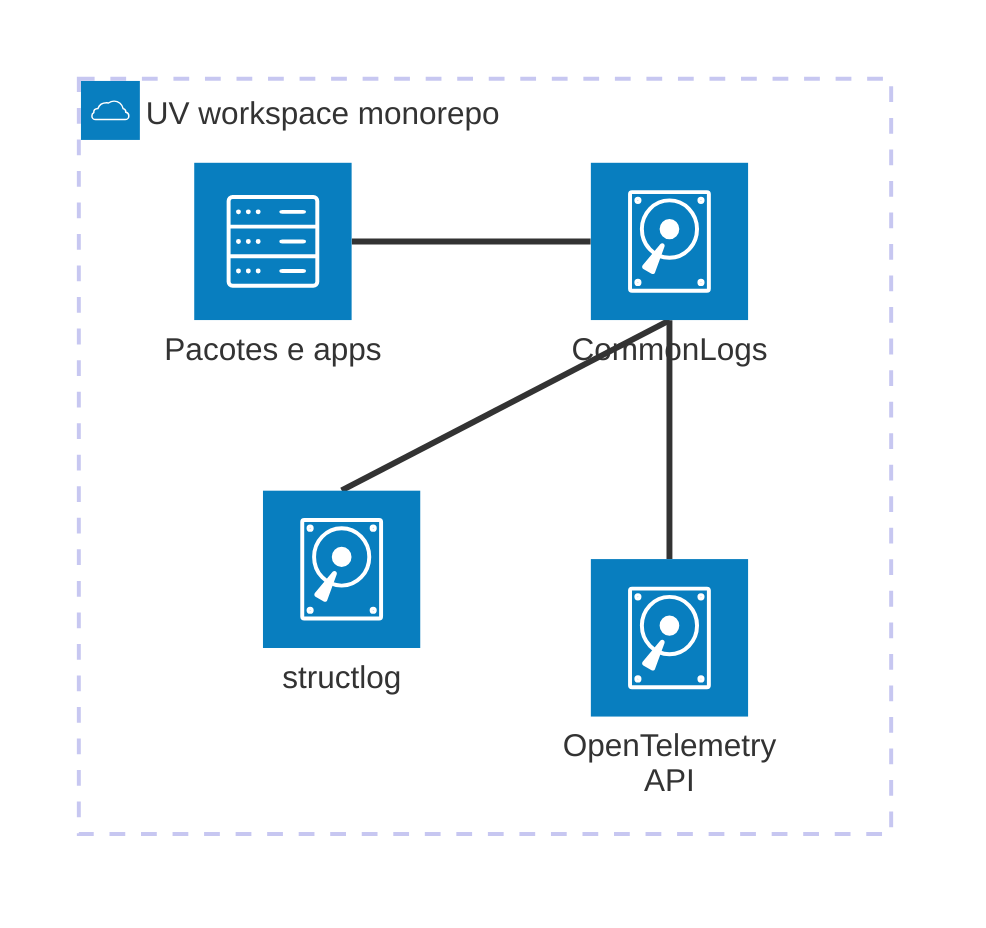

# Introdução

Lib compartilhada `common.logs` para logging estruturado no ecossistema Ressonant, no padrão usado em atlas/ressonant-bff. Centraliza a configuração com `setup_logging()`, integra `structlog` com o `logging` da biblioteca padrão (via `ProcessorFormatter`) e enriquece eventos com contexto **OpenTelemetry** (`trace_id` / `span_id`) quando há span ativo no contexto.

# Quick Start

1. Adicione `common-logs` como dependência do seu pacote:

```bash
uv add --package <seu-pacote> common-logs
```

Se preferir declarar manualmente no workspace:

```toml
[project]
dependencies = ["common-logs"]

[tool.uv.sources]
common-logs = { workspace = true }
```

2. Configure no boot da aplicação e obtenha o logger:

```python
from common.logs import get_logger, setup_logging

setup_logging()
logger = get_logger(__name__)
logger.info("app.started", version="1.0.0")
```

## API pública

- `setup_logging(settings=None)`
- `get_logger(name=None)`
- `add_trace_context` (processor; uso avançado)

Contexto por request (`bind_context`, `bound_context`, `unbind_context`, `clear_context`) **não** faz parte desta versão da lib. Para campos extras por evento, passe kwargs no log (`logger.info("evt", request_id=...)`).

3. Para rodar os testes da lib:

```bash
uv run pytest packages/logs/tests -v
```

Ou, no mesmo estilo de outros pacotes do monorepo:

```bash
uv run pytest packages/logs
```

## Configuração

`setup_logging(settings=None)` aceita objeto de settings opcional:

- `settings.logger_level` (ou `settings.log_level`) para nível de log.
- `settings.environment` para escolher o renderer (`local` usa console; outros ambientes usam JSON).

Sem settings, a lib lê:

- `LOG_LEVEL` (default: `INFO`)
- `ENVIRONMENT` (default: `local`)
- `DEPENDENCIES_LOGGER_LEVEL` (default: `WARNING`) — nível dos loggers de terceiros listados em `THIRD_PARTY_LOGGER_NAMES` ([`config.py`](src/common/logs/config.py)), independente do `LOG_LEVEL` da aplicação.

Em ambiente local, a saída é otimizada para leitura no terminal. Nos demais ambientes, a saída é JSON estruturado.

`setup_logging()` também rebaixa o access log (`uvicorn.access`) de rotas cujo path comece com `/internal/health` (healthcheck/liveness) para `DEBUG` — elas só aparecem no log se `LOG_LEVEL`/`LOGGER_LEVEL` estiver em `DEBUG`.

## Formato do log

Exemplo de payload em ambiente não-local (outros campos podem aparecer conforme o pipeline, por exemplo `thread`, `file`, `line`, `exception` em erro, `stack` com `stack_info=True`):

```json
{
  "message": "app.started",
  "level": "info",
  "timestamp": "2026-05-08T14:00:00.000000Z",
  "trace_id": "....",
  "span_id": "...."
}
```

# Read more

- [UV Workspaces](https://docs.astral.sh/uv/concepts/workspaces/)
- [structlog](https://www.structlog.org/)

# Deploy

Biblioteca interna do monorepo — não possui deploy independente. É distribuída como workspace member do UV e consumida diretamente pelos pacotes e aplicações do monorepo.

# Arquitetura

Visão macro: pacotes e aplicações do monorepo dependem de `common-logs`; a lib orquestra `structlog` e o `logging` stdlib, lê contexto de trace via `opentelemetry-api` e emite logs em console local ou JSON fora de local.



- O pipeline de processors (nível, callsite, trace, thread, exceções, timestamps, renderer final) está em [`config.py`](src/common/logs/config.py).
- Logs emitidos via stdlib passam pelo mesmo formatter, garantindo o mesmo formato que chamadas diretas ao structlog.

Estrutura do pacote:

```
packages/logs/
├── src/common/logs/
│   ├── __init__.py          # API pública (setup_logging, get_logger, add_trace_context)
│   └── config.py            # Pipeline structlog + stdlib + JSON
├── tests/
│   ├── conftest.py
│   ├── test_config.py
│   ├── test_conftest_isolation.py
│   ├── test_integration_otel.py
│   └── test_smoke.py
└── pyproject.toml
```

# Referências

- [structlog documentation](https://www.structlog.org/)
- [OpenTelemetry Python — API](https://opentelemetry.io/docs/languages/python/)